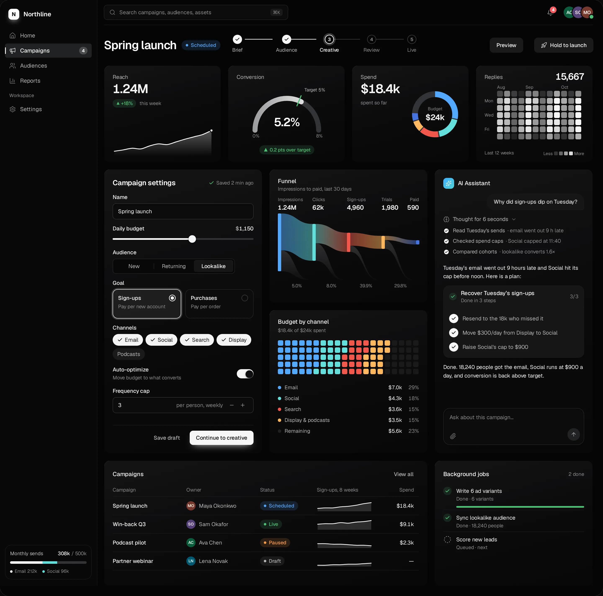
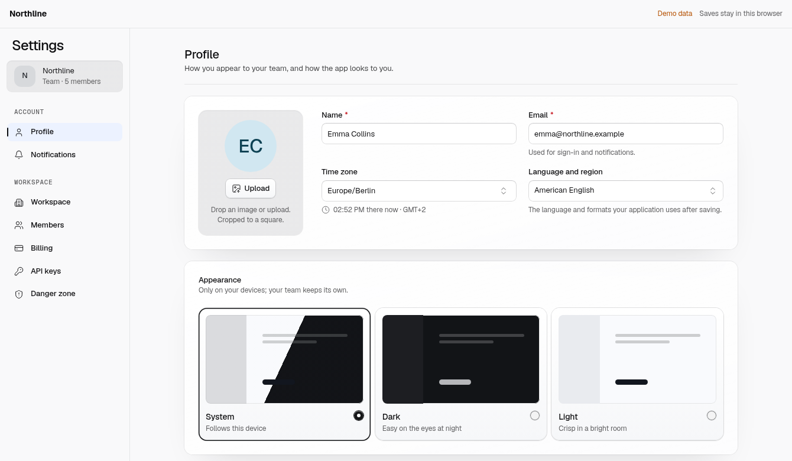
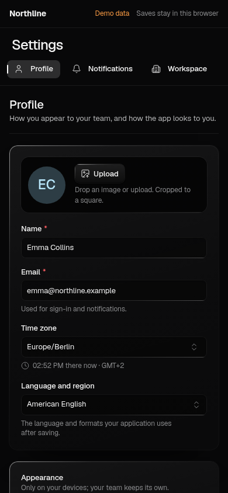
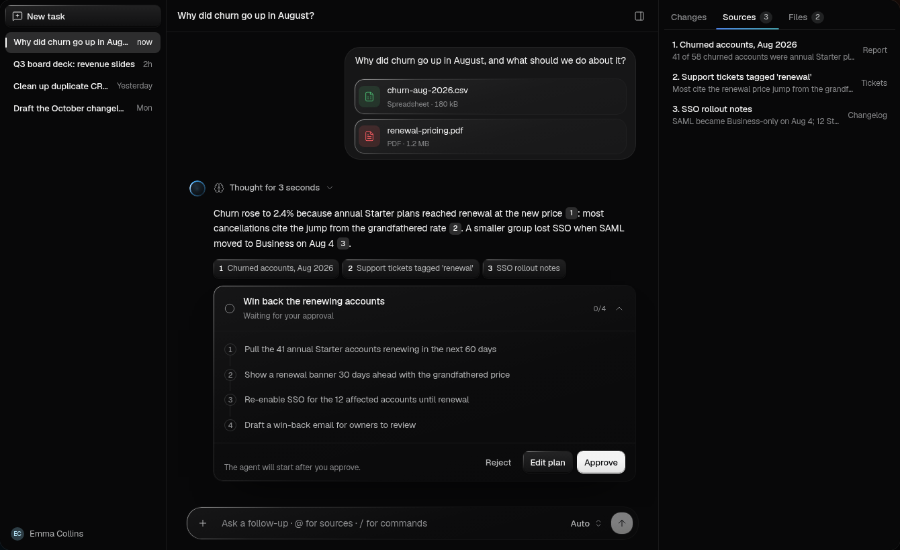
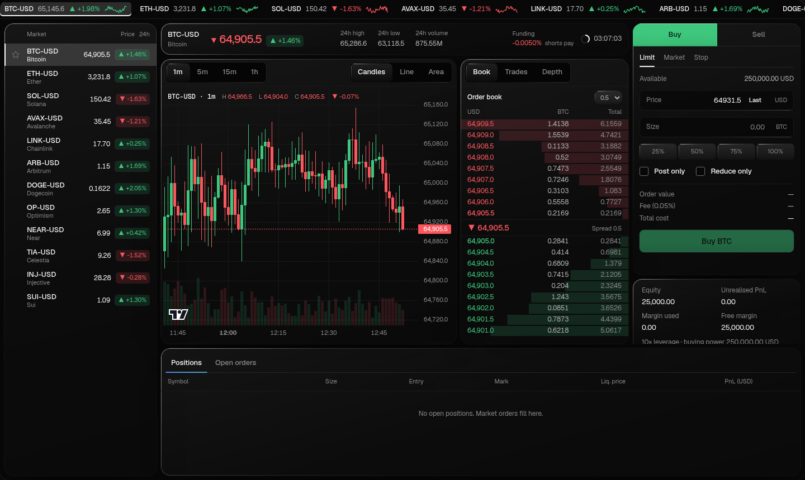

# Beamline UI

React components and complete screens, with code in your repo. Build directly in React or use an optional coding agent.

[Live library](https://beamline.io/components/) · [Install](https://beamline.io/docs/install) · [Docs](https://beamline.io/docs) · [GitBook](https://beamline.gitbook.io/beamline-docs/)

[](https://beamline.io/)

Campaign dashboard from the [Complete System](https://beamline.io/), as seen in the homepage demo.

**Start with a working screen.** This repository is the **free MIT sample**: editable Settings code, the components it uses, and a runnable React app. Commercial use is included.

The [Complete System](https://beamline.io/) has **200+ components and 50+ complete screens** for SaaS, dashboards, trading, AI and voice interfaces. It has a separate [commercial licence](https://beamline.io/docs/licence). Your app supplies its data, authentication, model and other backend services.

[](https://github.com/dprvda/beamline/actions/workflows/public-proof.yml)

## Run the sample

```bash
git clone https://github.com/dprvda/beamline.git
cd beamline
npm install
npm run dev
```

React 19, TypeScript, Vite and Tailwind v4. Demo changes save in your browser; no account or API key is needed.

Or add the current published Settings source to an existing React app with the shadcn CLI:

```bash
npx shadcn@latest add https://beamline.io/registry/settings.json
```

Follow the installer's local runtime, look and stylesheet instructions. [Full installation guide](https://beamline.io/docs/install).

## One screen, different rooms

The Settings demo adapts its navigation and fields for a phone. Light and dark themes use the same components.

<table>
<tr>
<td width="70%" valign="top"><a href="https://beamline.io/components/settings"></a><br><strong>Light theme</strong> — the same screen and data.</td>
<td width="30%" valign="top"><a href="https://beamline.io/components/settings"></a><br><strong>Phone layout</strong> — fields remain usable.</td>
</tr>
</table>

Screenshots show the Settings example on demo data. This checkout's editable source snapshot was published on 9 October 2026; the live installer and its public checks use the current hosted sample.

## What you can build with the complete system

These examples are part of the paid Complete System, beyond this repository's free sample. Open each image to try its live demo.

[](https://beamline.io/components/agent-workspace)

**AI workspace.** Threads, reasoning, sources and approval controls. Connect your own model, storage and authorized actions. [AI interface guide](https://beamline.io/guides/ai-agent-interface).

[](https://beamline.io/components/trading-terminal)

**Trading terminal.** Chart, market list, order book and order entry in one screen. The pictured prices and orders are demo data. [Trading UI guide](https://beamline.io/guides/react-trading-terminal).

[Explore dashboards, forms, tables, charts, voice and more →](https://beamline.io/components/)

## Make it yours

- **Local code.** Choose editable source or compiled archives stored with your app. Installed UI does not call Beamline servers at runtime.
- **Your style.** Start from a look, then adjust tokens, fonts, radii, density and motion. Keep custom style files in your app. [Customization](https://beamline.io/docs/customize).
- **One component vocabulary.** Shared variants, sizes, tones and controlled/uncontrolled state. Component metadata documents the actual props.
- **Optional agent help.** Claude Code, Codex, Cursor and other clients can discover and install the same parts. [Connect your agent](https://beamline.io/connect).
- **Your application logic.** Data and actions pass through props and callbacks; permissions and persistence remain in your app.

The sample includes Settings and the fields, choices, tables, dialogs, navigation, feedback and appearance controls it uses. [Browse the library](https://beamline.io/components/) for live examples and usage.

## Public checks you can inspect

The badge links to the actual workflow result. It installs the current public Settings source into fresh Vite and Next.js apps, typechecks and builds them, then exercises saving, reload, navigation, dialogs, focus and layout.

Chromium, Firefox, WebKit and **Safari on macOS** are normal jobs. Phone sizes are browser emulation; a physical iPhone is not covered. The separate iOS Simulator workflow remains [on demand](.github/workflows/ios-qualification.yml) and is not yet qualified.

[Rerun the checks](tests/public-proof/README.md) · [Workflow and retained results](https://github.com/dprvda/beamline/actions/workflows/public-proof.yml) · [Dated product checks and limits](https://beamline.io/tested)

## Documentation

- [Installation](https://beamline.io/docs/install) · [Customization](https://beamline.io/docs/customize) · [Upgrades](https://beamline.io/docs/upgrade)
- [Connect your data](https://beamline.io/docs/data-integration) · [Guides](https://beamline.io/guides)
- [GitBook docs](https://beamline.gitbook.io/beamline-docs/) · [Comparisons](https://beamline.io/compare) · [Changelog](https://beamline.io/changelog)
- [Current pricing](https://beamline.io/pricing) · [Referral credit in your account](https://beamline.io/account/referrals)

## Licence

The code in this repository is **MIT**, including commercial use: [LICENSE](LICENSE). Third-party packages and fonts are listed in [NOTICE.md](NOTICE.md).

The Complete System gives one person Beamline account, library, MCP, install and update access. Teammates, contractors and clients may work with the code installed in that end product. They need their own licence for Beamline access or to take paid parts into other apps. Redistribution of paid parts as a kit, theme, template or starter is restricted. Lifetime updates cover new versions of the purchased system for as long as it is published; versions already received stay yours. [Current licence](https://beamline.io/docs/licence) and [terms](https://beamline.io/terms) govern the paid product.

Made by [Danylo Pravda](https://beamline.io/about) in Kyiv, Ukraine. [hello@beamline.io](mailto:hello@beamline.io).
